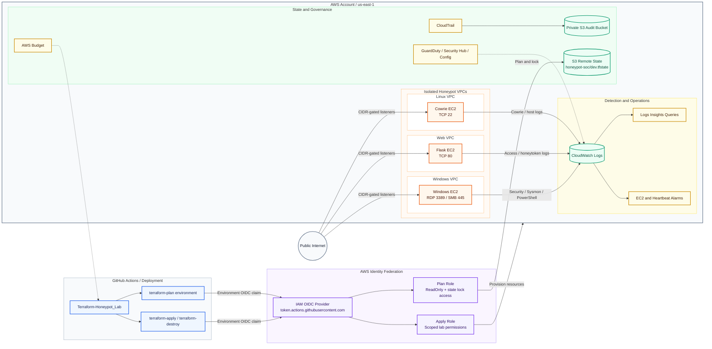
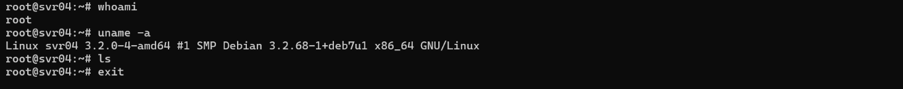
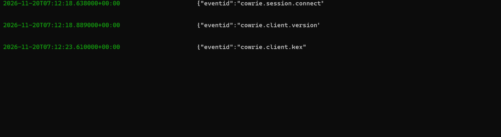
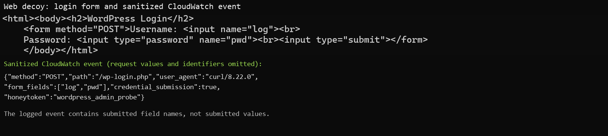
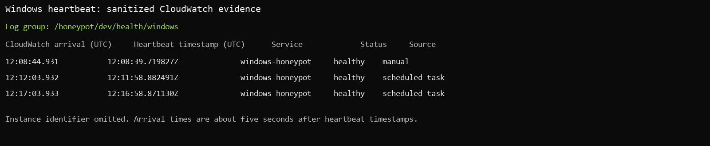
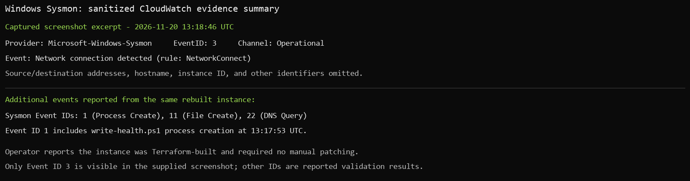
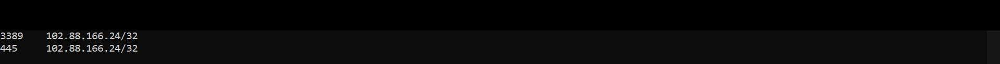
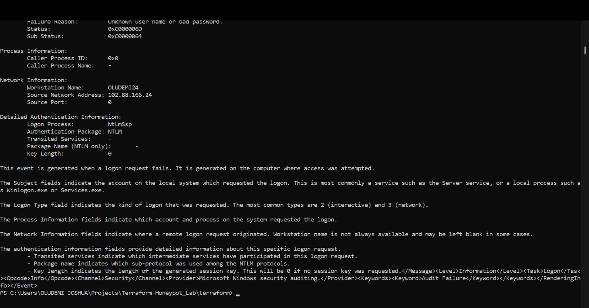
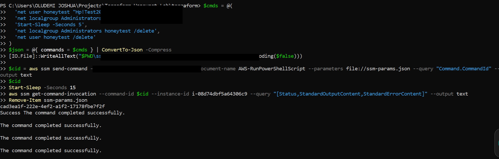

# Terraform Honeypot Lab

**Isolated, opt-in AWS honeypots with centralized logging, audit trails, and analyst-ready investigation queries, all provisioned with Terraform and deployed through OIDC-authenticated GitHub Actions.**


`Cloud Security` · `AWS` · `Terraform` · `Infrastructure as Code` · `SOC Engineering` · `Detection Engineering`

> [!WARNING]
> **This lab can cost money and expose hosts to the internet.** EC2, EBS, public
> IPv4, log ingestion and storage, S3, alarms, data transfer, and optional
> security services all bill, and Free Tier eligibility depends on your account.
> The AWS Budget sends alerts; it does **not** cap spending. Review the exact plan,
> exposure, and cost before you apply anything.

> [!NOTE]
> **Deployment and test status.** The operator reports that the Linux Cowrie, web,
> and Windows decoys are deployed and enabled. Controlled tests confirmed the
> event paths for each decoy and a working RDP failed-logon detection query. The
> evidence is point-in-time and scoped narrowly; see
> [Validation status](#validation-status) for exactly what each test does and does
> not show.

## Contents

- [Overview](#overview)
- [Architecture](#architecture)
- [Quick start](#quick-start)
- [Honeypot components](#honeypot-components)
- [Detection engineering](#detection-engineering)
- [Runtime evidence](#runtime-evidence)
- [Security design](#security-design)
- [CI/CD](#cicd)
- [Operational notes](#operational-notes)
- [Cost management](#cost-management)
- [Validation status](#validation-status)
- [Repository layout](#repository-layout)
- [Skills demonstrated](#skills-demonstrated)

## Overview

The lab demonstrates an end-to-end security monitoring workflow around three
optional decoys:

| Decoy | What it simulates | Telemetry |
|---|---|---|
| **Cowrie** (Linux) | SSH server on TCP 22 | Cowrie JSON events, host logs, heartbeat |
| **Flask app** (Linux) | WordPress, `.env`, and admin paths on TCP 80 | JSON access logs, honeytoken hits |
| **Windows Server** | RDP on TCP 3389 (SMB 445 optional) | Security, System, Sysmon, and PowerShell events |

**Key properties**

- **Opt-in starter configuration.** The example variables leave honeypot instances
  and optional security services disabled. The deployed dev environment is reported
  enabled.
- **Isolated.** Each decoy gets its own VPC, subnet, and security group, with no peering between them.
- **Explicit exposure.** Listener ingress exists only for enabled decoys and only for CIDRs you list in `honeypot_ingress_cidrs` (default: empty).
- **No public management ports.** There are no SSH or RDP admin rules. AWS Systems Manager is the intended admin path.
- **Centralized logging.** CloudWatch Logs collects decoy telemetry (7-day default retention) and CloudTrail records AWS management events.
- **Short-lived GitHub deployments.** GitHub Actions assumes separate plan and apply roles through AWS IAM OIDC federation, with no long-lived AWS access keys in workflows.
- **Guarded changes.** Normal plans that would delete or replace a resource are blocked; destruction goes through its own reviewed plan/apply flow.
- **Analyst-led investigation.** Nine saved CloudWatch Logs Insights queries support manual hunting. They are not scheduled detections or alert rules.

## Architecture



### Design decisions

| Decision | Detail | Trade-off |
|---|---|---|
| Separate VPC per decoy | No peering; independent subnets and security groups | More resources to manage |
| No NAT Gateway or load balancer | Lower cost and fewer moving parts | Instances use public IPv4 addresses |
| Egress limited to TCP 443 | Lets instances reach CloudWatch and Systems Manager | Destinations are **not** restricted to AWS endpoints, so arbitrary HTTPS egress remains a containment risk |
| CIDR-gated listeners | Ingress rules are created only when a decoy is enabled and CIDRs are set | Broad CIDRs mean Internet-wide exposure |
| Systems Manager for admin | Attaches `AmazonSSMManagedInstanceCore` when enabled | Requires SSM to be enabled |
| GitHub Actions OIDC roles | Separate plan and apply identities use environment claims and short-lived credentials | Trust conditions and environment protection still require external AWS/GitHub configuration |
| Separate OIDC Terraform state | `terraform/github-oidc/` uses local state and does not share the honeypot state | Local state must be protected and backed up separately from CI state |
| Ignore `ami` and `user_data` drift on instances | Prevents a new AMI or a rendering difference from replacing running decoys | Bootstrap-script edits and newer AMIs only reach an instance after a deliberate rebuild |

### Defaults

| Component | Purpose | Example default |
|---|---|---|
| Linux EC2 | Cowrie SSH decoy | Disabled |
| Web EC2 | Flask decoy | Disabled |
| Windows EC2 | RDP decoy with Sysmon and PowerShell telemetry | Disabled |
| SMB listener | Optional Windows TCP 445 exposure | Disabled |
| CloudWatch Logs | Application, host, and health logs | 7-day retention |
| CloudTrail + S3 | Management-event audit trail and storage | Enabled |
| GuardDuty, Security Hub, AWS Config | Optional findings and configuration recording | Disabled |
| AWS Budget | Monthly spend notifications | Enabled, USD 5 threshold |

These are starter values, not a description of the deployed dev environment.

## Quick start

**Prerequisites:** Terraform 1.10+, an AWS account and region, short-lived AWS
credentials for local operations, a globally unique S3 state bucket name, and an
email address for budget alerts.

Commands below use PowerShell. On macOS or Linux, use `cd` and `cp` instead of
`Set-Location` and `Copy-Item`, and forward slashes in paths.

### 1. Bootstrap remote state

```powershell
Set-Location terraform\bootstrap-state
Copy-Item terraform.tfvars.example terraform.tfvars
# Set a globally unique state bucket name and region.
terraform init
terraform fmt -check -recursive
terraform validate
terraform plan -out=bootstrap.tfplan
terraform show -no-color bootstrap.tfplan
# Apply only after reviewing the exact bootstrap plan:
terraform apply bootstrap.tfplan
```

Keep the bootstrap's local state in a protected location. The state bucket is
protected from destruction and is not part of lab teardown.

### 2. Configure and review the lab plan

```powershell
Set-Location ..\..
Copy-Item backend.hcl.example backend.hcl
Copy-Item environments\dev\terraform.tfvars.example environments\dev\terraform.tfvars
# Set the state bucket/region and budget_alert_email.
# Enable only the intended honeypot and set explicit listener CIDRs.
terraform init -backend-config=backend.hcl
terraform fmt -check -recursive
terraform validate
terraform plan -var-file=environments\dev\terraform.tfvars -out=tfplan
terraform show -no-color tfplan
```

Review the full plan, exposure, and cost before considering an apply, and apply
only the exact plan you reviewed.

### 3. (Optional) Set up GitHub Actions deployment

Deploying through GitHub needs the OIDC provider and the two roles first. They live
in a separate root module with its own local state:

```powershell
terraform -chdir=terraform\github-oidc init
terraform -chdir=terraform\github-oidc plan -var="state_bucket_name=<your-state-bucket>"
# Apply only after reviewing the plan.
```

Then create the GitHub environments `terraform-plan`, `terraform-apply` and
`terraform-destroy`, and set these repository variables:

| Variable | Value |
|---|---|
| `AWS_PLAN_ROLE_ARN` | ARN of the plan role |
| `AWS_APPLY_ROLE_ARN` | ARN of the apply role |
| `TF_STATE_BUCKET` | Name of the remote-state bucket |
| `TF_STATE_REGION` | Region of the remote-state bucket |

### 4. Tear down

```powershell
terraform plan -destroy -var-file=environments\dev\terraform.tfvars -out=tfplan
terraform show -no-color tfplan
# Apply only after reviewing the exact destroy plan:
terraform apply tfplan
```

Preserve any audit data you need, and do not destroy the state bucket. Afterward,
check for leftover EBS volumes and snapshots, S3 audit data, CloudWatch Logs,
public IPv4 usage, and your AWS bill.

> [!CAUTION]
> Never commit generated `.tfvars` files, backend configuration containing private
> details, state files (including `terraform/github-oidc/terraform.tfstate`),
> plans, credentials, or account-specific sensitive data.

## Honeypot components

### Cowrie SSH honeypot (Linux)

Runs Cowrie as a decoy on TCP 22 (not an administration service) and forwards its
JSON event log, host logs, and a service-health heartbeat to CloudWatch Logs.
The [captured runtime evidence](#linux-cowrie-runtime-evidence) shows a controlled
SSH session reaching the Cowrie log group.

### Flask web honeypot

Serves HTTP on TCP 80 with routes that mimic common WordPress, `.env`, and admin
probes. It logs JSON request events and honeytoken indicators. Form logging records
submitted field names and a credential-submission flag, **not** raw passwords. The
[runtime evidence](#web-honeypot-runtime-evidence) shows one controlled POST logged
with its field names and WordPress honeytoken.

### Windows RDP honeypot

Exposes an RDP decoy only when enabled and allowed by explicit CIDRs. SMB is a
separate opt-in. This is the most expensive component because of higher compute and
licensing costs.

**Telemetry when enabled:**

- Windows Security and System event collection
- Sysmon process, network, file, DNS, and selected registry events
- PowerShell script-block logging
- CloudWatch Agent forwarding for Windows events and service-health records

**Agent integrity.** The CloudWatch Agent MSI is pinned to version
`1.300074.1b2005`. Bootstrap checks the expected SHA-256
(`3891c26f477cc47cf1b3965b18ffb25532b67e4534b60f692cb6605b6bee1577`) before
installing. The package's Authenticode signature was reported valid, signed by
Amazon Web Services, Inc.

> [!NOTE]
> Public listener exposure is intentional for every decoy. Avoid broad CIDRs unless
> Internet-wide exposure is deliberate. Exposure can lead to host compromise,
> outbound abuse, and log-ingestion and data-transfer charges.

## Detection engineering

Nine version-controlled CloudWatch Logs Insights queries support manual
investigation. Terraform saves the definitions; it does not schedule them or open
incidents. Run them in CloudWatch Logs Insights over a time range you choose.

| Query | Source | Focus |
|---|---|---|
| [`cowrie-ssh-brute-force.sql`](detections/cloudwatch-logs-insights/cowrie-ssh-brute-force.sql) | Cowrie JSON | Failed SSH logins grouped by source |
| [`cowrie-command-execution.sql`](detections/cloudwatch-logs-insights/cowrie-command-execution.sql) | Cowrie JSON | Commands entered in shell sessions |
| [`cowrie-post-exploitation.sql`](detections/cloudwatch-logs-insights/cowrie-post-exploitation.sql) | Cowrie JSON | Download/execute, persistence, evasion, credential-file patterns |
| [`web-path-scanning.sql`](detections/cloudwatch-logs-insights/web-path-scanning.sql) | Flask access JSON | Repeated honeytoken and 404 path probes |
| [`windows-rdp-brute-force.sql`](detections/cloudwatch-logs-insights/windows-rdp-brute-force.sql) | Windows Security XML | Failed logons with a parsed source IP (≥ 5 per 5 minutes) |
| [`windows-suspicious-powershell.sql`](detections/cloudwatch-logs-insights/windows-suspicious-powershell.sql) | PowerShell and Sysmon XML | Suspicious PowerShell and evasion strings |
| [`windows-privilege-escalation.sql`](detections/cloudwatch-logs-insights/windows-privilege-escalation.sql) | Windows Security/System XML | Special privileges, service installs, scheduled tasks |
| [`windows-event-log-clearing.sql`](detections/cloudwatch-logs-insights/windows-event-log-clearing.sql) | Windows Security/System XML | Event-log clearing and related commands |
| [`windows-admin-activity.sql`](detections/cloudwatch-logs-insights/windows-admin-activity.sql) | Windows Security XML | Privileged logons, account/group changes, lockouts, audit-policy changes |

The Cowrie and web queries expect JSON fields emitted by those applications.
Windows queries parse XML event records inside CloudWatch Agent log messages. Only
the `windows-rdp-brute-force` query has been validated against real events; results
for the other queries and XML parsing across the remaining event channels still
need runtime validation.

See the [query guide](detections/cloudwatch-logs-insights/README.md) for details and
limitations. Restrict access to Cowrie logs, since attempted credentials may be
recorded, and keep retention short.

## Runtime evidence

All screenshots are redacted. Each test below is scoped to the specific requests
shown; none demonstrates sustained health or complete coverage.

### Linux Cowrie runtime evidence

One controlled SSH session dated 2026-11-20 (UTC) produced the full event chain:
`cowrie.session.connect`, `cowrie.client.version`, `cowrie.client.kex`,
`cowrie.login.success`, `cowrie.client.size`, `cowrie.session.params`, four
`cowrie.command.input` events, `cowrie.log.closed`, and `cowrie.session.closed`.
The terminal view shows the commands `whoami`, `uname -a`, `ls`, and `exit`.

This supports that Cowrie accepted the test connection, recorded the session, and
that the CloudWatch Agent delivered the log to `/honeypot/dev/linux/cowrie`. It is
not a negative test of other source CIDRs or a test of alarms and saved query output.

**Interactive Cowrie session**



**CloudWatch connection and handshake events**



**CloudWatch login, command, and session-close events**


### Web honeypot runtime evidence

A controlled POST to `/wp-login.php` appears in `/honeypot/dev/web/access`. The
event records `method: POST`, `form_fields: ["log", "pwd"]`,
`credential_submission: true`, and the `wordpress_admin_probe` honeytoken. The log
records field names, **not** submitted values, so no credentials appear in this
evidence.

This confirms the form-submission event path for the demonstrated request only.



### Windows heartbeat runtime evidence

Three `windows-honeypot` events with `status: healthy` appear in
`/honeypot/dev/health/windows` on 2026-11-20 (UTC): one manually triggered at about
12:08 UTC and two from the scheduled task at about 12:11 and 12:16 UTC. Each arrived
in CloudWatch roughly five seconds after its payload timestamp.

This confirms the health task ran unattended on the demonstrated schedule. It does
not establish continuous health or other Windows event collection.



### Windows Security and Sysmon runtime evidence

The operator reports that the rebuilt Windows instance was created by Terraform
without manual patching. CloudWatch received Windows Security and Sysmon telemetry;
observed Sysmon event IDs include 1 (Process Create), 3 (Network Connection),
11 (File Create), and 22 (DNS Query). Event ID 1 included creation of
`write-health.ps1` at 13:17:53 UTC, and the screenshot shows an Event ID 3 at
13:18:46 UTC.

This supports delivery for the demonstrated samples. It does not establish complete
event coverage or ongoing health.



### Windows ingress allow-list validation

The Windows security group shows both TCP 3389 and TCP 445 with a single `/32`
source as the ingress CIDR. This confirms that only the allow-listed source was
present at inspection time and why controlled attempts from it could reach the host.
It does not prove successful RDP or SMB authentication or test other source
addresses.



### Windows failed RDP logon evidence

Three controlled `mstsc` attempts generated Windows Security Event ID 4625 (An
account failed to log on). CloudWatch received them at 07:13:50, 07:14:00 and
07:14:08 UTC. The XML records show logon type 3 (network), NTLM authentication, a
failed account `fakeadmin`, and the test source address.

The sample path is:

`mstsc` attempt → TCP 3389 allow-list entry → Windows Security 4625 event →
CloudWatch Agent → XML record in `/honeypot/dev/windows/security`.

The `windows-rdp-brute-force` query was then validated in CloudWatch Logs Insights:

- The fixed XML regex parsed `src_ip` from the single-quoted XML and returned one
  source in three five-minute bins (07:10, 07:20, 07:30 UTC). The status showed
  `Showing 3 of 15 matched`.
- With `filter failures >= 5` enabled, the query scanned 223 Security records and
  returned exactly two rows: 07:30 UTC with 9 failures and 07:50 UTC with 8
  failures, both from the test source.

This confirms XML parsing, source grouping and the five-failure threshold on real
4625 events. It is not an alert or an ongoing-detection test.

**CloudWatch 4625 XML summary**


**Failed account and source details**


**Windows event metadata and failure explanation**



**CloudWatch Logs Insights source and time-bin aggregation**


**Validated `>= 5` brute-force threshold**


### Windows account lifecycle test

A PowerShell/SSM transcript shows a controlled test-account lifecycle:

1. `net user honeytest "<test-password>" /add` created the local account.
2. `net localgroup Administrators honeytest /add` added it to the local Administrators group.
3. `net localgroup Administrators honeytest /delete` removed it from the group.
4. `net user honeytest /delete` deleted the account.

The SSM invocation reported `Success` for all four commands, and the temporary
parameter file was deleted. The expected Security events are 4720 (user created),
4732 (member added to a local group), 4733 (member removed), and 4726 (user
deleted). This confirms the commands ran; it does not confirm that all four events
reached CloudWatch or that the Windows admin-activity query matched them.



## Security design

### Terraform remote state

The state bucket is created by the separate `terraform/bootstrap-state/` stack with:

- Server-side encryption and versioning
- S3 public-access blocking
- A TLS-only bucket policy
- Native S3 state locking (`use_lockfile`)
- `prevent_destroy`, so teardown never removes it

### IAM and GitHub OIDC

- EC2 instance roles grant CloudWatch log-delivery permissions for the configured log groups.
- When Systems Manager is enabled, the instance profile attaches `AmazonSSMManagedInstanceCore`.
- The separate [`terraform/github-oidc/`](terraform/github-oidc/) root module provisions the GitHub Actions OIDC provider and two deployment roles:
  - `honeypot-soc-dev-github-plan` trusts the `terraform-plan` environment and receives read-only plus state and lock-file access.
  - `honeypot-soc-dev-github-apply` trusts the `terraform-apply` and `terraform-destroy` environments and receives the scoped apply policy.
- The OIDC module deliberately uses local state and does not share the honeypot remote-state key. Back that state file up and keep it out of version control.
- Neither deployment role uses long-lived AWS access keys. GitHub environments, branch protection, trust claims and the applied policy must still be reviewed outside this repository.

**Trust policy `sub` format.** GitHub now includes the numeric owner and repository
IDs in the OIDC subject claim:

```text
repo:OWNER@OWNER_ID/REPO@REPO_ID:environment:NAME
```

Trust policies written in the older plain `repo:OWNER/REPO:environment:NAME` form
are rejected with `Not authorized to perform sts:AssumeRoleWithWebIdentity`. The
ID-based form also means a deleted and recreated repository with the same name
cannot inherit the trust. If a repository is renamed or transferred, update the
`plan_subs` and `apply_subs` variables to match.

## CI/CD

Workflows authenticate to AWS with GitHub Actions OIDC (short-lived credentials,
no long-lived access keys).

| Workflow | Purpose |
|---|---|
| [`terraform-ci.yml`](.github/workflows/terraform-ci.yml) | Formatting, backend-free init, validation, plan-guard tests |
| [`terraform-plan-apply.yml`](.github/workflows/terraform-plan-apply.yml) | Creates a plan artifact for review and fails if the plan contains deletes or replacements; does not apply |
| [`terraform-apply.yml`](.github/workflows/terraform-apply.yml) | Applies the exact saved plan after confirmation and provenance checks |
| [`terraform-destroy.yml`](.github/workflows/terraform-destroy.yml) | Creates a separate destroy plan for review |
| [`terraform-destroy-apply.yml`](.github/workflows/terraform-destroy-apply.yml) | Applies the reviewed destroy plan after confirmation and provenance checks |

Normal apply plans are guarded against resource deletions and replacements;
destruction uses its own plan/apply flow.

**Before using the workflows**, configure GitHub environment reviewers, branch
restrictions, AWS OIDC trust policies, and appropriately scoped plan/apply IAM
permissions. Repository validation has not verified these external settings.

## Operational notes

Lessons from running this pipeline, kept here because they are easy to hit again.

**OIDC role assumption fails with "Not authorized".** Compare the token's `sub`
claim with the role's trust policy character for character. The usual cause is the
ID-based `sub` format described in [Security design](#iam-and-github-oidc). To see
the claims, temporarily decode the JWT payload in a workflow step (print claims
only, never the token), then remove the step.

**Line endings.** The repository enforces LF with `.gitattributes`
(`* text=auto eol=lf`). Without it, a Windows checkout rendered the `user_data`
templates with CRLF while the Linux runner rendered LF. Terraform saw different
strings and planned to replace all three instances. Check a working tree with
`git ls-files --eol`; every file should show `w/lf`.

**Instance lifecycle.** The honeypot `aws_instance` resources use
`ignore_changes = [ami, user_data]`. Bootstrap-script edits and newer AMIs do not
reach running instances until you rebuild them through the protected destroy
workflow. The plan guard blocks replacements in normal plans, so this is a
deliberate, reviewed step rather than a surprise.

**Local plans differ from CI.** CI supplies the plan inputs as `TF_VAR_*`
environment variables and the state bucket at `init`. A local plan without the same
values prompts for variables and can show different changes, so diagnose from the
CI log where possible.

## Cost management

**Defaults that limit spend:** honeypots off, GuardDuty, Security Hub, and AWS
Config off, no NAT Gateway or load balancer, and a 7-day CloudWatch retention.

**What to keep in mind:**

- Budget alerts (USD 5 monthly threshold) do not cap spending or stop resources.
- Stopping an EC2 instance does not remove EBS storage, snapshots, S3 objects, CloudWatch Logs, or every public IPv4 charge.
- Estimate your region, run time, storage, traffic, logging, and optional services before deploying.
- Review the destroy plan before teardown, then check for residual billable resources.

## Validation status

| Evidence available | Scope and remaining limitations |
|---|---|
| Terraform formatting, validation, backend-free initialization, and plan-guard tests are covered by CI | These static checks do not validate an account-specific plan or deployment |
| Supplied EC2 screenshot shows three instances Running with 3/3 checks | Names are truncated; this is point-in-time EC2 status evidence |
| One Cowrie SSH test session appears in the CloudWatch event stream | Confirms the Linux event path for this session only; not continuous health or other source CIDRs |
| One web POST appears in `/honeypot/dev/web/access` with the expected form fields, submission flag, and honeytoken | Confirms the event path for this request; the event contains field names, not submitted values |
| Three healthy Windows heartbeat events appear in `/honeypot/dev/health/windows`, two from the scheduled task | Confirms the health task ran unattended and heartbeat delivery for these samples; not continuous health |
| Windows Security and Sysmon events reached CloudWatch on the rebuilt Terraform-created instance; Sysmon Event IDs 1, 3, 11, and 22 were observed | Confirms delivery for the reported samples; not complete event coverage |
| TCP 3389 and TCP 445 both show the single test `/32` in the Windows security-group output | Confirms the allow-list at inspection time; not successful RDP/SMB authentication or negative CIDR testing |
| The `windows-rdp-brute-force` query parsed the 4625 source and returned exactly two rows (07:30 with 9 failures, 07:50 with 8) at the `>= 5` threshold | Confirms parsing, grouping and threshold on real events; not an alert or ongoing-detection test |
| An SSM account-lifecycle test created `honeytest`, added it to Administrators, removed it, and deleted it | Confirms the four `net` commands completed; the matching Security events are not a verified CloudWatch record |
| The `terraform/github-oidc/` module is applied, and `terraform plan` reports no changes against AWS | The module uses local state; GitHub environment protection and branch rules are not verified here |
| A manual run of `terraform-plan-apply.yml` assumed the plan role through OIDC, initialized remote state, created a plan, and passed the destructive-change guard | Apply-role runs (`terraform-apply`, `terraform-destroy-apply`) have not been demonstrated by this evidence |
| Repository contains nine saved Logs Insights query definitions | Only the RDP brute-force query has demonstrated output |
| Windows telemetry is configured in Terraform and bootstrap files | Other Windows query results and broader event-channel coverage still require validation |

## Repository layout

```text
terraform/
  bootstrap-state/       # Separate S3 backend bucket bootstrap
  github-oidc/           # Separate local-state OIDC provider and deployment roles
  environments/dev/      # Development composition and example variables
  modules/
    networking/          # Isolated VPCs, routes, security groups
    iam/                 # EC2 instance profile and log-write permissions
    linux-honeypot/      # Cowrie EC2 component
    web-honeypot/        # Flask decoy EC2 component
    windows-honeypot/    # Windows EC2 and telemetry configuration
    monitoring/          # CloudWatch log groups and saved queries
    security/            # CloudTrail, budget, alarms, optional security services
  scripts/guard-plan.py  # Blocks plans that delete or replace resources
detections/
  cloudwatch-logs-insights/   # Saved query definitions and query guide
.github/workflows/            # CI, plan, apply, and destroy workflows
docs/deployment-evidence/     # Redacted EC2, Linux, web, and Windows runtime evidence
.gitattributes                # Enforces LF line endings
```

Terraform variables control honeypot exposure and optional services. Resources are
tagged with the project, environment, and security-telemetry classification.

## Skills demonstrated

- Designing isolated, intentionally exposed decoy environments in AWS
- Building reusable Terraform modules
- Federating CI/CD to AWS with OIDC, separate plan and apply roles, and short-lived credentials
- Diagnosing identity, state, and cross-platform rendering problems in a real pipeline
- Centralizing host and application telemetry with bounded retention
- Turning investigation goals into version-controlled, runtime-validated Logs Insights queries
- Protecting Terraform state and separating plan, apply, and teardown with a replacement guard
- Weighing cost, operational risk, public exposure, and evidence requirements

## Author

**Oludemi Joshua**
Cybersecurity | Cloud Security | Blue Team | Security Automation

Building practical security solutions across cloud infrastructure, identity,
monitoring, and security engineering.
