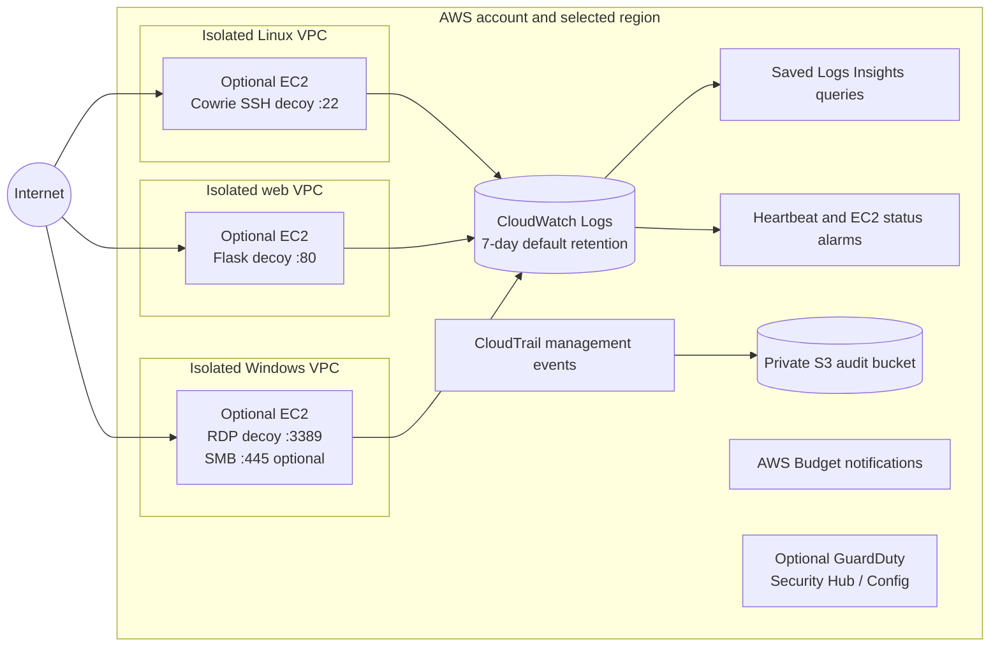

# Terraform Honeypot Lab

**Isolated, opt-in AWS honeypots with centralized logging, audit trails, and analyst-ready investigation queries, all provisioned with Terraform.**


`Cloud Security` · `AWS` · `Terraform` · `Infrastructure as Code` · `SOC Engineering` · `Detection Engineering`

> [!WARNING]
> **Not yet deployed.** The repository has passed static validation only. No AWS
> plan or apply has been run, and no live honeypot behavior, telemetry, or
> detection result has been verified.
>
> **This lab can cost money and expose hosts to the internet.** EC2, EBS, public
> IPv4, log ingestion and storage, S3, alarms, data transfer, and optional
> security services all bill, and Free Tier eligibility depends on your account.
> The AWS Budget sends alerts; it does **not** cap spending. Review the exact plan,
> exposure, and cost before you apply anything.

## Contents

- [Overview](#overview)
- [Architecture](#architecture)
- [Quick start](#quick-start)
- [Honeypot components](#honeypot-components)
- [Detection engineering](#detection-engineering)
- [Security design](#security-design)
- [CI/CD](#cicd)
- [Cost management](#cost-management)
- [Validation status](#validation-status)
- [Repository layout](#repository-layout)
- [Skills demonstrated](#skills-demonstrated)

## Overview

The lab demonstrates an end-to-end security monitoring workflow around three
optional decoys:

| Decoy | What it simulates | Telemetry |
|---|---|---|
| **Cowrie** (Linux) | SSH server on TCP 22 | Cowrie JSON events, host logs, heartbeat |
| **Flask app** (Linux) | WordPress, `.env`, and admin paths on TCP 80 | JSON access logs, honeytoken hits |
| **Windows Server** | RDP on TCP 3389 (SMB 445 optional) | Security, System, Sysmon, and PowerShell events |

**Key properties**

- **Off by default.** Every honeypot and optional security service is disabled until you enable it.
- **Isolated.** Each decoy gets its own VPC, subnet, and security group, with no peering between them.
- **Explicit exposure.** Listener ingress exists only for enabled decoys and only for CIDRs you list in `honeypot_ingress_cidrs` (default: empty).
- **No public management ports.** There are no SSH or RDP admin rules. AWS Systems Manager is the intended admin path.
- **Centralized logging.** CloudWatch Logs collects decoy telemetry (7-day default retention) and CloudTrail records AWS management events.
- **Analyst-led investigation.** Nine saved CloudWatch Logs Insights queries support manual hunting. They are not scheduled detections or alert rules.

## Architecture



### Design decisions

| Decision | Detail | Trade-off |
|---|---|---|
| Separate VPC per decoy | No peering; independent subnets and security groups | More resources to manage |
| No NAT Gateway or load balancer | Lower cost and fewer moving parts | Instances use public IPv4 addresses |
| Egress limited to TCP 443 | Lets instances reach CloudWatch and Systems Manager | Destinations are **not** restricted to AWS endpoints, so arbitrary HTTPS egress remains a containment risk |
| CIDR-gated listeners | Ingress rules are created only when a decoy is enabled and CIDRs are set | Broad CIDRs mean Internet-wide exposure |
| Systems Manager for admin | Attaches `AmazonSSMManagedInstanceCore` when enabled | Requires SSM to be enabled |

### Defaults

| Component | Purpose | Default |
|---|---|---|
| Linux EC2 | Cowrie SSH decoy | Disabled |
| Web EC2 | Flask decoy | Disabled |
| Windows EC2 | RDP decoy with Sysmon and PowerShell telemetry | Disabled |
| SMB listener | Optional Windows TCP 445 exposure | Disabled |
| CloudWatch Logs | Application, host, and health logs | 7-day retention |
| CloudTrail + S3 | Management-event audit trail and storage | Enabled |
| GuardDuty, Security Hub, AWS Config | Optional findings and configuration recording | Disabled |
| AWS Budget | Monthly spend notifications | Enabled, USD 5 threshold |

## Quick start

**Prerequisites:** Terraform 1.10+, an AWS account and region, short-lived AWS
credentials for local operations, a globally unique S3 state bucket name, and an
email address for budget alerts.

Commands below use PowerShell. On macOS or Linux, use `cd` and `cp` instead of
`Set-Location` and `Copy-Item`, and forward slashes in paths.

### 1. Bootstrap remote state

```powershell
Set-Location terraform\bootstrap-state
Copy-Item terraform.tfvars.example terraform.tfvars
# Set a globally unique state bucket name and region.
terraform init
terraform fmt -check -recursive
terraform validate
terraform plan -out=bootstrap.tfplan
terraform show -no-color bootstrap.tfplan
# Apply only after reviewing the exact bootstrap plan:
terraform apply bootstrap.tfplan
```

Keep the bootstrap's local state in a protected location. The state bucket is
protected from destruction and is not part of lab teardown.

### 2. Configure and review the lab plan

```powershell
Set-Location ..\..
Copy-Item backend.hcl.example backend.hcl
Copy-Item environments\dev\terraform.tfvars.example environments\dev\terraform.tfvars
# Set the state bucket/region and budget_alert_email.
# Enable only the intended honeypot and set explicit listener CIDRs.
terraform init -backend-config=backend.hcl
terraform fmt -check -recursive
terraform validate
terraform plan -var-file=environments\dev\terraform.tfvars -out=tfplan
terraform show -no-color tfplan
```

Review the full plan, exposure, and cost before considering an apply, and apply
only the exact plan you reviewed.

### 3. Tear down

```powershell
terraform plan -destroy -var-file=environments\dev\terraform.tfvars -out=tfplan
terraform show -no-color tfplan
# Apply only after reviewing the exact destroy plan:
terraform apply tfplan
```

Preserve any audit data you need, and do not destroy the state bucket. Afterward,
check for leftover EBS volumes and snapshots, S3 audit data, CloudWatch Logs,
public IPv4 usage, and your AWS bill.

> [!CAUTION]
> Never commit generated `.tfvars` files, backend configuration containing private
> details, state files, plans, credentials, or account-specific sensitive data.

## Honeypot components

### Cowrie SSH honeypot (Linux)

Runs Cowrie as a decoy on TCP 22 (not an administration service) and forwards its
JSON event log, host logs, and a service-health heartbeat to CloudWatch Logs.

### Flask web honeypot

Serves HTTP on TCP 80 with routes that mimic common WordPress, `.env`, and admin
probes. It logs JSON request events and honeytoken indicators. Form logging records
submitted field names and a credential-submission flag, **not** raw passwords.

### Windows RDP honeypot

Exposes an RDP decoy only when enabled and allowed by explicit CIDRs. SMB is a
separate opt-in. This is the most expensive component because of higher compute and
licensing costs.

**Telemetry when enabled:**

- Windows Security and System event collection
- Sysmon process, network, file, DNS, and selected registry events
- PowerShell script-block logging
- CloudWatch Agent forwarding for Windows events and service-health records

**Agent integrity.** The CloudWatch Agent MSI is pinned to version
`1.300074.1b2005`. Bootstrap checks the expected SHA-256
(`3891c26f477cc47cf1b3965b18ffb25532b67e4534b60f692cb6605b6bee1577`) before
installing. The package's Authenticode signature was reported valid, signed by
Amazon Web Services, Inc. This verifies the package only; it is not evidence of a
Windows deployment.

> [!NOTE]
> Public listener exposure is intentional for every decoy. Avoid broad CIDRs unless
> Internet-wide exposure is deliberate. Exposure can lead to host compromise,
> outbound abuse, and log-ingestion and data-transfer charges.

## Detection engineering

Nine version-controlled CloudWatch Logs Insights queries support manual
investigation. Terraform saves the definitions; it does not schedule them or open
incidents. Run them in CloudWatch Logs Insights over a time range you choose.

| Query | Source | Focus |
|---|---|---|
| [`cowrie-ssh-brute-force.sql`](detections/cloudwatch-logs-insights/cowrie-ssh-brute-force.sql) | Cowrie JSON | Failed SSH logins grouped by source |
| [`cowrie-command-execution.sql`](detections/cloudwatch-logs-insights/cowrie-command-execution.sql) | Cowrie JSON | Commands entered in shell sessions |
| [`cowrie-post-exploitation.sql`](detections/cloudwatch-logs-insights/cowrie-post-exploitation.sql) | Cowrie JSON | Download/execute, persistence, evasion, credential-file patterns |
| [`web-path-scanning.sql`](detections/cloudwatch-logs-insights/web-path-scanning.sql) | Flask access JSON | Repeated honeytoken and 404 path probes |
| [`windows-rdp-brute-force.sql`](detections/cloudwatch-logs-insights/windows-rdp-brute-force.sql) | Windows Security XML | Failed logons with a parsed source IP |
| [`windows-suspicious-powershell.sql`](detections/cloudwatch-logs-insights/windows-suspicious-powershell.sql) | PowerShell and Sysmon XML | Suspicious PowerShell and evasion strings |
| [`windows-privilege-escalation.sql`](detections/cloudwatch-logs-insights/windows-privilege-escalation.sql) | Windows Security/System XML | Special privileges, service installs, scheduled tasks |
| [`windows-event-log-clearing.sql`](detections/cloudwatch-logs-insights/windows-event-log-clearing.sql) | Windows Security/System XML | Event-log clearing and related commands |
| [`windows-admin-activity.sql`](detections/cloudwatch-logs-insights/windows-admin-activity.sql) | Windows Security XML | Privileged logons, account/group changes, lockouts, audit-policy changes |

The Cowrie and web queries expect JSON fields emitted by those applications.
Windows queries parse XML event records inside CloudWatch Agent log messages. The
queries and configured event sources are consistent at the repository level, but
Windows XML parsing and all detection behavior still need runtime validation
against real CloudWatch samples. No live detection results are claimed.

See the [query guide](detections/cloudwatch-logs-insights/README.md) for details and
limitations. Restrict access to Cowrie logs, since attempted credentials may be
recorded, and keep retention short.

## Security design

### Terraform remote state

The state bucket is created by the separate `terraform/bootstrap-state/` stack with:

- Server-side encryption and versioning
- S3 public-access blocking
- A TLS-only bucket policy
- Native S3 state locking (`use_lockfile`)
- `prevent_destroy`, so teardown never removes it

### IAM

- EC2 instance roles grant CloudWatch log-delivery permissions for the configured log groups.
- When Systems Manager is enabled, the instance profile attaches `AmazonSSMManagedInstanceCore`.
- GitHub deployment roles and their policies are configured separately and should be reviewed for least privilege.

## CI/CD

Workflows authenticate to AWS with GitHub Actions OIDC (short-lived credentials,
no long-lived access keys).

| Workflow | Purpose |
|---|---|
| [`terraform-ci.yml`](.github/workflows/terraform-ci.yml) | Formatting, backend-free init, validation, plan-guard tests |
| [`terraform-plan-apply.yml`](.github/workflows/terraform-plan-apply.yml) | Creates a plan artifact for review; does not apply |
| [`terraform-apply.yml`](.github/workflows/terraform-apply.yml) | Applies the exact saved plan after confirmation and provenance checks |
| [`terraform-destroy.yml`](.github/workflows/terraform-destroy.yml) | Creates a separate destroy plan for review |
| [`terraform-destroy-apply.yml`](.github/workflows/terraform-destroy-apply.yml) | Applies the reviewed destroy plan after confirmation and provenance checks |

Normal apply plans are guarded against resource deletions and replacements;
destruction uses its own plan/apply flow.

**Before using the workflows**, configure GitHub environment reviewers, branch
restrictions, AWS OIDC trust policies, and appropriately scoped plan/apply IAM
permissions. Repository validation has not verified these external settings.

## Cost management

**Defaults that limit spend:** honeypots off, GuardDuty, Security Hub, and AWS
Config off, no NAT Gateway or load balancer, and a 7-day CloudWatch retention.

**What to keep in mind:**

- Budget alerts (USD 5 monthly threshold) do not cap spending or stop resources.
- Stopping an EC2 instance does not remove EBS storage, snapshots, S3 objects, CloudWatch Logs, or every public IPv4 charge.
- Estimate your region, run time, storage, traffic, logging, and optional services before deploying.
- Review the destroy plan before teardown, then check for residual billable resources.

## Validation status

| Verified (static, repository level) | Not verified |
|---|---|
| Terraform fmt and validate, main stack | Any AWS deployment, plan, or apply |
| Terraform fmt and validate, state bootstrap | Live honeypot behavior |
| Terraform init with backend disabled | Log collection at runtime |
| Both plan-guard unit tests | Detection query results (Windows XML parsing especially) |
| YAML parsing of six workflow files | GitHub environment, OIDC, and IAM configuration |
| `git diff --check` | Account-specific cost and exposure |

## Repository layout

```text
terraform/
  bootstrap-state/       # Separate S3 backend bucket bootstrap
  environments/dev/      # Development composition and example variables
  modules/
    networking/          # Isolated VPCs, routes, security groups
    iam/                 # EC2 instance profile and log-write permissions
    linux-honeypot/      # Cowrie EC2 component
    web-honeypot/        # Flask decoy EC2 component
    windows-honeypot/    # Windows EC2 and telemetry configuration
    monitoring/          # CloudWatch log groups and saved queries
    security/            # CloudTrail, budget, alarms, optional security services
detections/
  cloudwatch-logs-insights/   # Saved query definitions and query guide
.github/workflows/            # CI, plan, apply, and destroy workflows
```

Terraform variables control honeypot exposure and optional services. Resources are
tagged with the project, environment, and security-telemetry classification.

## Skills demonstrated

- Designing isolated, intentionally exposed decoy environments in AWS
- Building reusable Terraform modules
- Applying IAM roles, instance profiles, and short-lived CI/CD authentication
- Centralizing host and application telemetry with bounded retention
- Turning investigation goals into version-controlled Logs Insights queries
- Protecting Terraform state and separating plan, apply, and teardown
- Weighing cost, operational risk, public exposure, and evidence requirements

## Author

**Oludemi Joshua**
Cybersecurity | Cloud Security | Blue Team | Security Automation

Building practical security solutions across cloud infrastructure, identity,
monitoring, and security engineering.
