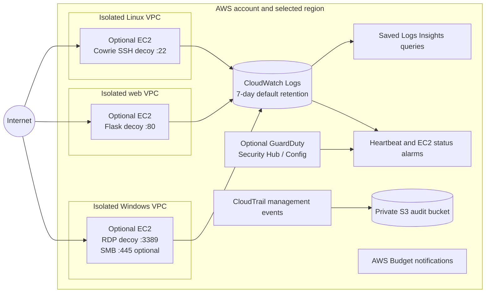

# Honeypot SOC Lab V2

**Cloud Security | AWS | Terraform | Infrastructure as Code | SOC Engineering | Detection Engineering**

A practical cloud security lab built with AWS-native services and Terraform. It
provisions isolated, optional honeypots and the supporting logging, audit, and
investigation infrastructure used to study suspicious activity.

> **Deployment status:** The infrastructure has passed static repository validation;
> it has not been deployed. No account-specific AWS plan or apply has been performed,
> and no live honeypot behavior or production telemetry has been verified.
>
> **Cost and exposure warning:** AWS pricing and Free Tier eligibility depend on your
> account, offer, region, and usage. EC2, EBS, public IPv4, log ingestion and storage,
> S3, alarms, budgets, data transfer, and optional security services can incur charges.
> AWS Budget notifications are alerts, not spending limits. Review the exact plan,
> public exposure, and cost implications before applying it.

## Project overview

The lab demonstrates a security monitoring workflow built around three optional
decoys:

- Cowrie SSH honeypot on Linux.
- Flask web application decoy with honeytoken paths.
- Windows Server RDP honeypot with host and PowerShell telemetry.

Each decoy has an independent network environment. CloudWatch centralizes selected
host and application logs, while CloudTrail records AWS management events. Saved
CloudWatch Logs Insights queries support analyst-led investigation; they are not
scheduled detections or production alert rules.

Honeypots are disabled by default. Listener ingress requires explicitly configured
CIDRs, and there are no public SSH or RDP management rules. Systems Manager is the
intended management path when enabled.

## Technology stack

| Area | Technologies |
|---|---|
| Infrastructure as code | Terraform 1.10+, AWS provider |
| Networking and compute | Amazon VPC, security groups, Amazon EC2 |
| Decoys | Cowrie, Flask, optional Windows Server |
| Logging and audit | Amazon CloudWatch Logs, CloudWatch alarms, AWS CloudTrail, Amazon S3 |
| Detection investigation | CloudWatch Logs Insights saved queries |
| Identity and administration | IAM roles and instance profiles, AWS Systems Manager |
| Optional security services | Amazon GuardDuty, AWS Security Hub, AWS Config |
| Automation | GitHub Actions, AWS OIDC, Python plan guard |

## AWS architecture



Linux, web, and Windows decoys have separate VPCs, subnets, and security groups, with
no peering between them. The design has no NAT Gateway or load balancer. Listener
rules are created only for enabled decoys and explicitly configured
`honeypot_ingress_cidrs`; the default list is empty. Enabled instances receive public
IPv4 addresses, so the configured CIDRs control which sources can reach the listener
ports.

Instance security-group egress is limited to TCP 443, but destinations are not
restricted to AWS endpoints. Arbitrary HTTPS egress remains a containment trade-off.
No SSH/RDP management ingress is configured; Systems Manager is intended for
administration when enabled.

| Component | Purpose | Default |
|---|---|---|
| Linux EC2 | Cowrie SSH decoy and Cowrie JSON telemetry | Disabled |
| Web EC2 | Flask decoy with honeytoken paths and JSON access logs | Disabled |
| Windows EC2 | RDP decoy with Windows, Sysmon, and PowerShell telemetry | Disabled |
| CloudWatch Logs | Centralized application, host, and health logs | 7-day retention |
| CloudTrail and S3 | Management-event audit trail and audit-object storage | Enabled |
| GuardDuty, Security Hub, AWS Config | Optional security findings/configuration recording | Disabled |
| SMB listener | Optional Windows TCP 445 decoy exposure | Disabled |
| AWS Budget | Monthly spending notifications | Enabled; USD 5 threshold |

## Honeypot components and network security

### Linux SSH honeypot

The Linux component runs Cowrie and forwards its JSON event log, host logs, and a
service-health heartbeat to CloudWatch Logs. Cowrie listens on TCP 22 as a decoy; it
is not an SSH administration service.

### Web application honeypot

The Flask decoy exposes HTTP on TCP 80 when enabled. Its routes include common
WordPress, `.env`, and admin probes, and it records JSON request events and honeytoken
indicators. Form logging records submitted field names and a credential-submission
flag, not raw password values.

### Windows RDP honeypot

The optional Windows Server component exposes the RDP decoy listener only when
enabled and allowed by explicit CIDRs. SMB remains separately opt-in. The Windows
instance is disabled by default and can incur higher compute and licensing costs.

For every decoy, public listener exposure is intentional and controlled by the
configured ingress CIDRs. Avoid broad CIDRs unless Internet-wide honeypot exposure is
deliberate. Internet exposure can result in host compromise, outbound abuse, log
ingestion, and data-transfer charges.

## Detection engineering

Nine version-controlled CloudWatch Logs Insights query definitions support focused,
manual investigation of decoy activity. Terraform saves the query definitions; it
does not schedule them or create per-query incidents. Analysts run them in CloudWatch
Logs Insights over a selected time range.

| Query | Log source and format | Investigation focus |
|---|---|---|
| [`cowrie-ssh-brute-force.sql`](detections/cloudwatch-logs-insights/cowrie-ssh-brute-force.sql) | Cowrie JSON | Failed SSH logins grouped by source |
| [`cowrie-command-execution.sql`](detections/cloudwatch-logs-insights/cowrie-command-execution.sql) | Cowrie JSON | Commands entered in Cowrie shell sessions |
| [`cowrie-post-exploitation.sql`](detections/cloudwatch-logs-insights/cowrie-post-exploitation.sql) | Cowrie JSON | Download/execute, persistence, evasion, and credential-file command patterns |
| [`web-path-scanning.sql`](detections/cloudwatch-logs-insights/web-path-scanning.sql) | Flask access JSON | Repeated honeytoken/404 path probes |
| [`windows-rdp-brute-force.sql`](detections/cloudwatch-logs-insights/windows-rdp-brute-force.sql) | Windows Security event XML | Failed logons with a parsed source IP |
| [`windows-suspicious-powershell.sql`](detections/cloudwatch-logs-insights/windows-suspicious-powershell.sql) | PowerShell and Sysmon event XML | Suspicious PowerShell and evasion-related strings |
| [`windows-privilege-escalation.sql`](detections/cloudwatch-logs-insights/windows-privilege-escalation.sql) | Windows Security/System event XML | Special privileges, service installation, and scheduled-task indicators |
| [`windows-event-log-clearing.sql`](detections/cloudwatch-logs-insights/windows-event-log-clearing.sql) | Windows Security/System event XML | Event-log clearing records and command indicators |
| [`windows-admin-activity.sql`](detections/cloudwatch-logs-insights/windows-admin-activity.sql) | Windows Security event XML | Privileged logons, account/group changes, lockouts, and audit-policy changes |

The Cowrie and web queries expect JSON fields emitted by their respective
applications. Windows queries inspect XML event records in CloudWatch Agent log
messages. The query definitions and configured event sources are consistent at the
repository level, but Windows XML parsing and all detection behavior require runtime
validation against actual CloudWatch samples. No live detection results are claimed.

The [query guide](detections/cloudwatch-logs-insights/README.md) describes the query
set and its limitations. Restrict access to Cowrie logs because attempted
credentials may be recorded, and keep retention short.

## Windows security telemetry and CloudWatch Agent integrity

When enabled, Windows configuration includes:

- Windows Security and System event collection.
- Sysmon process, network, file, DNS, and selected registry telemetry.
- PowerShell script-block logging.
- CloudWatch Agent forwarding for Windows events and service-health records.

The CloudWatch Agent MSI is pinned to version **1.300074.1b2005**. Bootstrap verifies
the expected SHA-256
`3891c26f477cc47cf1b3965b18ffb25532b67e4534b60f692cb6605b6bee1577` before
installation. The MSI's Authenticode signature was reported valid, with signer
**Amazon Web Services, Inc.** This package verification is not evidence that a
Windows instance has been deployed. Windows remains disabled by default.

## Terraform modular infrastructure

```text
terraform/
  bootstrap-state/       # Separate S3 backend bucket bootstrap
  environments/dev/      # Development composition and example variables
  modules/
    networking/          # Isolated VPCs, routes, security groups
    iam/                 # EC2 instance profile and log-write permissions
    linux-honeypot/      # Cowrie EC2 component
    web-honeypot/        # Flask decoy EC2 component
    windows-honeypot/    # Windows EC2 and telemetry configuration
    monitoring/          # CloudWatch log groups and saved queries
    security/            # CloudTrail, budget, alarms, optional security services
```

Environment variables control honeypot exposure and optional services. Resource tags
identify the project, environment, and security-telemetry classification. The EC2 role
grants CloudWatch log-delivery permissions for configured log groups. When Systems
Manager is enabled, the instance profile attaches the AWS-managed
`AmazonSSMManagedInstanceCore` policy. GitHub deployment roles and their policies are
configured separately and should be reviewed for least privilege.

## Terraform remote state security

The S3 state bucket is created by the separate `terraform/bootstrap-state/` stack.
Its configuration enables server-side encryption, versioning, S3 public-access
blocking, a TLS-only bucket policy, and native S3 state locking (`use_lockfile`).
`prevent_destroy` protects the bucket from Terraform destruction, and lab teardown
does not include it. Store the bootstrap's local state securely until the remote
backend is configured; never commit state or generated backend credentials/config.

## GitHub Actions CI/CD and AWS OIDC

The Terraform workflows use GitHub Actions OIDC for short-lived AWS credentials,
not long-lived AWS access keys:

| Workflow | Purpose |
|---|---|
| [`terraform-ci.yml`](.github/workflows/terraform-ci.yml) | Formatting, backend-free initialization, validation, and plan-guard tests |
| [`terraform-plan-apply.yml`](.github/workflows/terraform-plan-apply.yml) | Creates a plan artifact for review; does not apply |
| [`terraform-apply.yml`](.github/workflows/terraform-apply.yml) | Applies the exact saved plan after confirmation and provenance checks |
| [`terraform-destroy.yml`](.github/workflows/terraform-destroy.yml) | Creates a separate destroy plan for review |
| [`terraform-destroy-apply.yml`](.github/workflows/terraform-destroy-apply.yml) | Applies the reviewed destroy plan after confirmation and provenance checks |

Normal apply plans are guarded against resource deletions and replacements. Destruction
uses a separate plan/apply flow. GitHub environment reviewers, branch restrictions,
AWS OIDC trust policies, and appropriately scoped plan/apply IAM permissions must be
configured before using the workflows. These external settings have not been verified
by repository validation.

## Cost management

Cost-conscious defaults include disabled honeypots, disabled GuardDuty, Security Hub,
and AWS Config, no NAT Gateway or load balancer, and configurable CloudWatch retention
with a seven-day default. The AWS Budget is configured with a USD 5 monthly notification
threshold.

Budget alerts do **not** cap spending or automatically stop resources. EC2 shutdown
does not remove EBS storage, snapshots, S3 objects, CloudWatch Logs, or every public
IPv4 charge. Estimate the chosen region, run time, storage, traffic, logging, and
optional service use before deployment. Review a destroy plan before teardown and
check for residual billable resources afterward.

## Validation and testing

Repository-level static checks have passed:

- Terraform formatting and validation for the main stack.
- Terraform formatting and validation for the state-bootstrap configuration.
- Terraform initialization with the backend disabled.
- Both plan-guard unit tests.
- YAML parsing of six GitHub Actions workflow files at the time of validation.
- `git diff --check`.

These checks do not deploy infrastructure, authenticate to AWS, validate an
account-specific plan, or establish that log collection and detections work at
runtime. No AWS infrastructure has been deployed, no AWS apply has been performed,
and no account-specific AWS plan has been verified. No live honeypot behavior or
production telemetry has been tested. Detection queries still require runtime
validation against actual CloudWatch samples.

## Setup and deployment

Prerequisites include Terraform 1.10+, an AWS account and region, short-lived AWS
credentials for local operations, a unique S3 state bucket name, and a notification
email for the default budget.

### 1. Bootstrap remote state

```powershell
Set-Location terraform\bootstrap-state
Copy-Item terraform.tfvars.example terraform.tfvars
# Set a globally unique state bucket name and region.
terraform init
terraform fmt -check -recursive
terraform validate
terraform plan -out=bootstrap.tfplan
terraform show -no-color bootstrap.tfplan
# Apply only after reviewing the exact bootstrap plan:
terraform apply bootstrap.tfplan
```

Keep the bootstrap local state in a protected location. The state bucket is protected
from destruction and is not part of lab teardown.

### 2. Configure and review the lab plan

```powershell
Set-Location ..\..
Copy-Item backend.hcl.example backend.hcl
Copy-Item environments\dev\terraform.tfvars.example environments\dev\terraform.tfvars
# Set the state bucket/region and budget_alert_email.
# Enable only the intended honeypot and set explicit listener CIDRs.
terraform init -backend-config=backend.hcl
terraform fmt -check -recursive
terraform validate
terraform plan -var-file=environments\dev\terraform.tfvars -out=tfplan
terraform show -no-color tfplan
```

Review the full plan, exposure, and cost before considering an apply. Apply only the
exact reviewed plan; the GitHub process also requires its reviewed plan artifact,
provenance checks, explicit confirmation, and protected-environment approval.

## Teardown

Create and review a destroy plan before applying it:

```powershell
terraform plan -destroy -var-file=environments\dev\terraform.tfvars -out=tfplan
terraform show -no-color tfplan
# Apply only after reviewing the exact destroy plan:
terraform apply tfplan
```

Preserve required audit data and do not destroy the separately managed state bucket.
After teardown, inspect EBS volumes and snapshots, S3 audit data, CloudWatch Logs,
public IPv4 usage, and AWS Billing.

Do not commit generated `.tfvars`, backend configuration containing private details,
state files, plans, credentials, or account-specific sensitive information.

## Project objectives and skills demonstrated

- Design isolated, intentionally exposed decoy environments in AWS.
- Provision and configure infrastructure through reusable Terraform modules.
- Apply IAM roles, instance profiles, and short-lived CI/CD authentication patterns.
- Collect host and application telemetry centrally and bound log retention.
- Translate investigation goals into version-controlled CloudWatch Logs Insights
  queries.
- Protect Terraform state and separate plan review from apply and teardown.
- Evaluate cost, operational risk, public exposure, and evidence requirements.

## Author

**Oludemi Joshua**

Cybersecurity | Cloud Security | Blue Team | Security Automation

Building practical security solutions across cloud infrastructure, identity,
monitoring, and security engineering.
