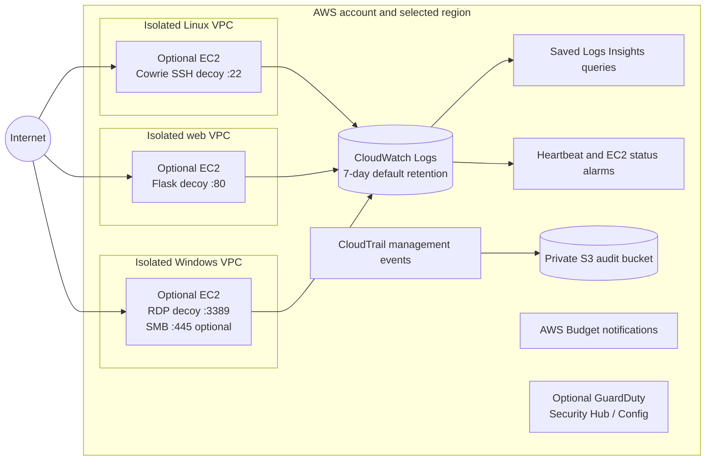
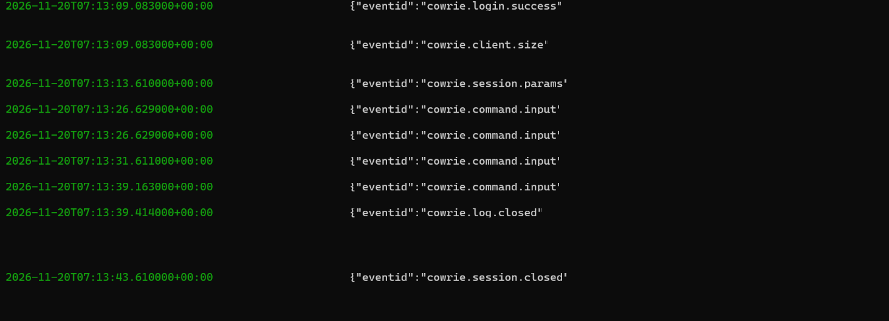
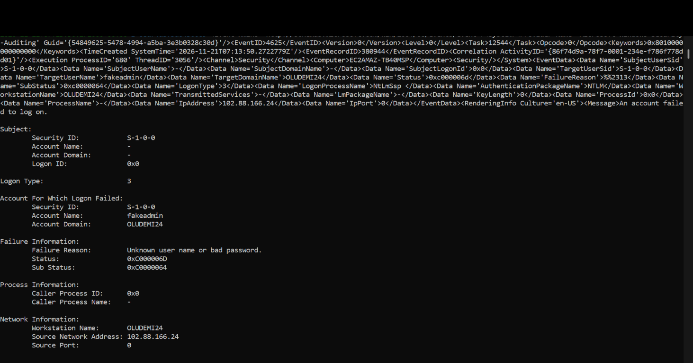
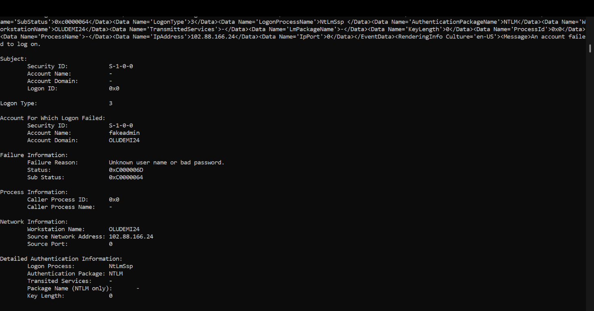
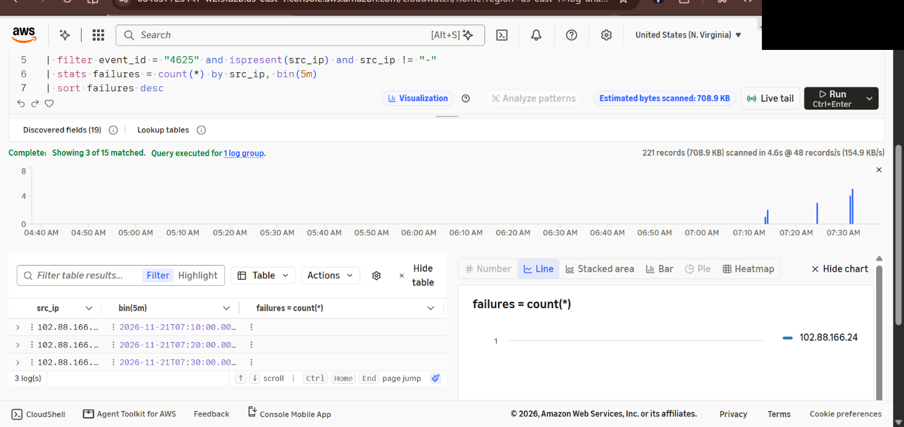
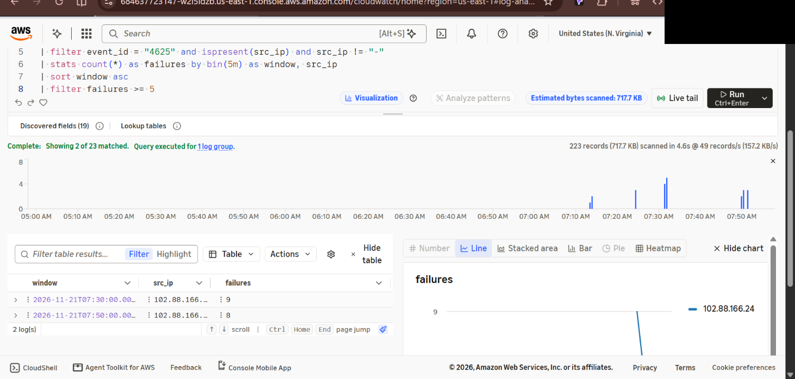

# Terraform Honeypot Lab

**Isolated, opt-in AWS honeypots with centralized logging, audit trails, and analyst-ready investigation queries, all provisioned with Terraform.**


`Cloud Security` · `AWS` · `Terraform` · `Infrastructure as Code` · `SOC Engineering` · `Detection Engineering`

> [!WARNING]
> **Deployment and test status:** The operator reports that the Linux Cowrie, web,
> and Windows decoys are deployed and enabled. A supplied
> [EC2 screenshot](docs/deployment-evidence/ec2-instances-running.png) shows three
> instances Running with 3/3 status checks; the Name column is truncated. In a
> controlled Linux SSH session, Cowrie events were observed in
> `/honeypot/dev/linux/cowrie` from connection through session close. A separate
> controlled web form submission appears in `/honeypot/dev/web/access` with the
> expected POST, field-name, credential-submission, and honeytoken metadata. These
> tests verify the event paths for those requests only. Three healthy Windows
> heartbeat events, including two scheduled-task runs, were also observed in
> CloudWatch. On the rebuilt, Terraform-created Windows instance, Windows Security
> and Sysmon events were also observed in CloudWatch, including Sysmon Event IDs 1,
> 3, 11, and 22. These samples verify the reported event paths, not saved-query
> results or ongoing health. Three controlled RDP failed-logon attempts were then
> confirmed end to end: Windows Security Event ID 4625 arrived in CloudWatch at
> 07:13:50, 07:14:00 and 07:14:08 UTC with source address 102.88.166.24.
> This validates RDP ingress, the allow-list, Security-channel collection, the
> CloudWatch Agent and XML delivery for the attempts. The same 4625 pipeline was
> later validated through the `windows-rdp-brute-force` Logs Insights query:
> the `>= 5` threshold returned two bins, 07:30 with 9 failures and 07:50 with
> 8 failures, both from `102.88.166.24`.
>
> **This lab can cost money and expose hosts to the internet.** EC2, EBS, public
> IPv4, log ingestion and storage, S3, alarms, data transfer, and optional
> security services all bill, and Free Tier eligibility depends on your account.
> The AWS Budget sends alerts; it does **not** cap spending. Review the exact plan,
> exposure, and cost before you apply anything.

## Contents

- [Overview](#overview)
- [Architecture](#architecture)
- [Quick start](#quick-start)
- [Honeypot components](#honeypot-components)
- [Detection engineering](#detection-engineering)
- [Linux Cowrie runtime evidence](#linux-cowrie-runtime-evidence)
- [Web honeypot runtime evidence](#web-honeypot-runtime-evidence)
- [Windows heartbeat runtime evidence](#windows-heartbeat-runtime-evidence)
- [Windows Security and Sysmon runtime evidence](#windows-security-and-sysmon-runtime-evidence)
- [Windows failed RDP logon evidence](#windows-failed-rdp-logon-evidence)
- [Windows ingress allow-list validation](#windows-ingress-allow-list-validation)
- [Security design](#security-design)
- [CI/CD](#cicd)
- [Cost management](#cost-management)
- [Validation status](#validation-status)
- [Repository layout](#repository-layout)
- [Skills demonstrated](#skills-demonstrated)

## Overview

The lab demonstrates an end-to-end security monitoring workflow around three
optional decoys:

| Decoy | What it simulates | Telemetry |
|---|---|---|
| **Cowrie** (Linux) | SSH server on TCP 22 | Cowrie JSON events, host logs, heartbeat |
| **Flask app** (Linux) | WordPress, `.env`, and admin paths on TCP 80 | JSON access logs, honeytoken hits |
| **Windows Server** | RDP on TCP 3389 (SMB 445 optional) | Security, System, Sysmon, and PowerShell events |

**Key properties**

- **Opt-in starter configuration.** The example variables leave honeypot instances
  and optional security services disabled. The deployed dev environment is reported
  enabled; see the deployment and runtime evidence below.
- **Isolated.** Each decoy gets its own VPC, subnet, and security group, with no peering between them.
- **Explicit exposure.** Listener ingress exists only for enabled decoys and only for CIDRs you list in `honeypot_ingress_cidrs` (default: empty).
- **No public management ports.** There are no SSH or RDP admin rules. AWS Systems Manager is the intended admin path.
- **Centralized logging.** CloudWatch Logs collects decoy telemetry (7-day default retention) and CloudTrail records AWS management events.
- **Analyst-led investigation.** Nine saved CloudWatch Logs Insights queries support manual hunting. They are not scheduled detections or alert rules.

## Architecture



### Design decisions

| Decision | Detail | Trade-off |
|---|---|---|
| Separate VPC per decoy | No peering; independent subnets and security groups | More resources to manage |
| No NAT Gateway or load balancer | Lower cost and fewer moving parts | Instances use public IPv4 addresses |
| Egress limited to TCP 443 | Lets instances reach CloudWatch and Systems Manager | Destinations are **not** restricted to AWS endpoints, so arbitrary HTTPS egress remains a containment risk |
| CIDR-gated listeners | Ingress rules are created only when a decoy is enabled and CIDRs are set | Broad CIDRs mean Internet-wide exposure |
| Systems Manager for admin | Attaches `AmazonSSMManagedInstanceCore` when enabled | Requires SSM to be enabled |

### Defaults

| Component | Purpose | Example default |
|---|---|---|
| Linux EC2 | Cowrie SSH decoy | Disabled |
| Web EC2 | Flask decoy | Disabled |
| Windows EC2 | RDP decoy with Sysmon and PowerShell telemetry | Disabled |
| SMB listener | Optional Windows TCP 445 exposure | Disabled |
| CloudWatch Logs | Application, host, and health logs | 7-day retention |
| CloudTrail + S3 | Management-event audit trail and storage | Enabled |
| GuardDuty, Security Hub, AWS Config | Optional findings and configuration recording | Disabled |
| AWS Budget | Monthly spend notifications | Enabled, USD 5 threshold |

These are starter values, not a description of the deployed dev environment. The
operator reports all three honeypot instances enabled; the EC2 screenshot linked
above shows three running instances.

## Quick start

**Prerequisites:** Terraform 1.10+, an AWS account and region, short-lived AWS
credentials for local operations, a globally unique S3 state bucket name, and an
email address for budget alerts.

Commands below use PowerShell. On macOS or Linux, use `cd` and `cp` instead of
`Set-Location` and `Copy-Item`, and forward slashes in paths.

### 1. Bootstrap remote state

```powershell
Set-Location terraform\bootstrap-state
Copy-Item terraform.tfvars.example terraform.tfvars
# Set a globally unique state bucket name and region.
terraform init
terraform fmt -check -recursive
terraform validate
terraform plan -out=bootstrap.tfplan
terraform show -no-color bootstrap.tfplan
# Apply only after reviewing the exact bootstrap plan:
terraform apply bootstrap.tfplan
```

Keep the bootstrap's local state in a protected location. The state bucket is
protected from destruction and is not part of lab teardown.

### 2. Configure and review the lab plan

```powershell
Set-Location ..\..
Copy-Item backend.hcl.example backend.hcl
Copy-Item environments\dev\terraform.tfvars.example environments\dev\terraform.tfvars
# Set the state bucket/region and budget_alert_email.
# Enable only the intended honeypot and set explicit listener CIDRs.
terraform init -backend-config=backend.hcl
terraform fmt -check -recursive
terraform validate
terraform plan -var-file=environments\dev\terraform.tfvars -out=tfplan
terraform show -no-color tfplan
```

Review the full plan, exposure, and cost before considering an apply, and apply
only the exact plan you reviewed.

### 3. Tear down

```powershell
terraform plan -destroy -var-file=environments\dev\terraform.tfvars -out=tfplan
terraform show -no-color tfplan
# Apply only after reviewing the exact destroy plan:
terraform apply tfplan
```

Preserve any audit data you need, and do not destroy the state bucket. Afterward,
check for leftover EBS volumes and snapshots, S3 audit data, CloudWatch Logs,
public IPv4 usage, and your AWS bill.

> [!CAUTION]
> Never commit generated `.tfvars` files, backend configuration containing private
> details, state files, plans, credentials, or account-specific sensitive data.

## Honeypot components

### Cowrie SSH honeypot (Linux)

Runs Cowrie as a decoy on TCP 22 (not an administration service) and forwards its
JSON event log, host logs, and a service-health heartbeat to CloudWatch Logs.
The [captured runtime evidence](#linux-cowrie-runtime-evidence) shows a controlled
SSH session reaching the Cowrie log group.

### Flask web honeypot

Serves HTTP on TCP 80 with routes that mimic common WordPress, `.env`, and admin
probes. It logs JSON request events and honeytoken indicators. Form logging records
submitted field names and a credential-submission flag, **not** raw passwords. The
[runtime evidence](#web-honeypot-runtime-evidence) shows one controlled POST logged
with its field names and WordPress honeytoken.

### Windows RDP honeypot

Exposes an RDP decoy only when enabled and allowed by explicit CIDRs. SMB is a
separate opt-in. This is the most expensive component because of higher compute and
licensing costs.

The [Windows heartbeat evidence](#windows-heartbeat-runtime-evidence) confirms that
the health task ran on schedule and its healthy status reached CloudWatch. That
heartbeat evidence alone does not demonstrate full Windows Security, System, Sysmon,
or PowerShell event coverage; separate [Windows Security and Sysmon runtime
evidence](#windows-security-and-sysmon-runtime-evidence) documents the observed
Security and Sysmon events.

**Telemetry when enabled:**

- Windows Security and System event collection
- Sysmon process, network, file, DNS, and selected registry events
- PowerShell script-block logging
- CloudWatch Agent forwarding for Windows events and service-health records

**Agent integrity.** The CloudWatch Agent MSI is pinned to version
`1.300074.1b2005`. Bootstrap checks the expected SHA-256
(`3891c26f477cc47cf1b3965b18ffb25532b67e4534b60f692cb6605b6bee1577`) before
installing. The package's Authenticode signature was reported valid, signed by
Amazon Web Services, Inc. This verifies the package only; it is not evidence of a
Windows deployment.

> [!NOTE]
> Public listener exposure is intentional for every decoy. Avoid broad CIDRs unless
> Internet-wide exposure is deliberate. Exposure can lead to host compromise,
> outbound abuse, and log-ingestion and data-transfer charges.

## Detection engineering

Nine version-controlled CloudWatch Logs Insights queries support manual
investigation. Terraform saves the definitions; it does not schedule them or open
incidents. Run them in CloudWatch Logs Insights over a time range you choose.

| Query | Source | Focus |
|---|---|---|
| [`cowrie-ssh-brute-force.sql`](detections/cloudwatch-logs-insights/cowrie-ssh-brute-force.sql) | Cowrie JSON | Failed SSH logins grouped by source |
| [`cowrie-command-execution.sql`](detections/cloudwatch-logs-insights/cowrie-command-execution.sql) | Cowrie JSON | Commands entered in shell sessions |
| [`cowrie-post-exploitation.sql`](detections/cloudwatch-logs-insights/cowrie-post-exploitation.sql) | Cowrie JSON | Download/execute, persistence, evasion, credential-file patterns |
| [`web-path-scanning.sql`](detections/cloudwatch-logs-insights/web-path-scanning.sql) | Flask access JSON | Repeated honeytoken and 404 path probes |
| [`windows-rdp-brute-force.sql`](detections/cloudwatch-logs-insights/windows-rdp-brute-force.sql) | Windows Security XML | Failed logons with a parsed source IP |
| [`windows-suspicious-powershell.sql`](detections/cloudwatch-logs-insights/windows-suspicious-powershell.sql) | PowerShell and Sysmon XML | Suspicious PowerShell and evasion strings |
| [`windows-privilege-escalation.sql`](detections/cloudwatch-logs-insights/windows-privilege-escalation.sql) | Windows Security/System XML | Special privileges, service installs, scheduled tasks |
| [`windows-event-log-clearing.sql`](detections/cloudwatch-logs-insights/windows-event-log-clearing.sql) | Windows Security/System XML | Event-log clearing and related commands |
| [`windows-admin-activity.sql`](detections/cloudwatch-logs-insights/windows-admin-activity.sql) | Windows Security XML | Privileged logons, account/group changes, lockouts, audit-policy changes |

The Cowrie and web queries expect JSON fields emitted by those applications.
Windows queries parse XML event records inside CloudWatch Agent log messages. The
queries and configured event sources are consistent at the repository level. The
captured Cowrie session and web POST event verify delivery for those test requests,
and Windows heartbeat, Security, and Sysmon evidence verifies delivery for the
reported samples. These observations do not verify saved query results, broad event
coverage, or ongoing health. Windows query results and XML parsing across the
configured event channels still need runtime validation.

See the [query guide](detections/cloudwatch-logs-insights/README.md) for details and
limitations. Restrict access to Cowrie logs, since attempted credentials may be
recorded, and keep retention short.

## Linux Cowrie runtime evidence

The supplied CloudWatch output captures one controlled SSH session dated
2026-11-20 (UTC). Its event chain includes `cowrie.session.connect`,
`cowrie.client.version`, `cowrie.client.kex`, `cowrie.login.success`,
`cowrie.client.size`, `cowrie.session.params`, four `cowrie.command.input` events,
`cowrie.log.closed`, and `cowrie.session.closed`. The associated terminal view shows
the commands `whoami`, `uname -a`, `ls`, and `exit`.

This evidence supports that Cowrie accepted the test connection, recorded the
session events, and that the CloudWatch Agent delivered the Cowrie JSON log for
this session to `/honeypot/dev/linux/cowrie`. It also demonstrates a successful
connection from the configured test source. It is not a negative test of other
source CIDRs, proof that every allow-list edge case works, or a test of alarms and
saved query output. The screenshots have identifying fields and submitted
credentials redacted.

**Interactive Cowrie session**


**CloudWatch connection and handshake events**


**CloudWatch login, command, and session-close events**



## Web honeypot runtime evidence

The supplied screenshot shows the WordPress-style login form and a controlled POST
to `/wp-login.php` observed in the `/honeypot/dev/web/access` CloudWatch log group.
The event records `method: POST`, `form_fields: ["log", "pwd"]`,
`credential_submission: true`, and the `wordpress_admin_probe` honeytoken. The log
records submitted field names, **not** the submitted values, so credentials are not
included in this evidence.

This confirms the form-submission event path for the demonstrated request only. It
does not establish sustained health, behavior for every route or request type,
saved-query results, or any Windows behavior (see the Windows evidence below). The
screenshot is a sanitized composite:
request values and identifying network/instance details are omitted.


## Windows heartbeat runtime evidence

The supplied CloudWatch output contains three `windows-honeypot` events with
`status: healthy` in `/honeypot/dev/health/windows` on 2026-11-20 (UTC). One was
manually triggered at about 12:08 UTC; the other two were generated by the scheduled
task at about 12:11 and 12:16 UTC. Each event arrived in CloudWatch approximately
five seconds after the timestamp recorded in the heartbeat payload.

This confirms the Windows health check ran unattended on the demonstrated schedule
and that its heartbeat reached CloudWatch promptly for these samples. By itself,
this heartbeat evidence does not establish continuous health, other Windows event
collection, or the results of Windows Logs Insights queries. The screenshot omits
the instance identifier.


## Windows Security and Sysmon runtime evidence

The operator reports that the rebuilt Windows instance was created by Terraform
without manual patching. CloudWatch received Windows Security and Sysmon telemetry;
the observed Sysmon event IDs include 1 (Process Create), 3 (Network Connection),
11 (File Create), and 22 (DNS Query). The Event ID 1 stream included creation of
`write-health.ps1` at 13:17:53 UTC, and the supplied screenshot shows a Sysmon
Event ID 3 network-connection event at 13:18:46 UTC.

This evidence supports that the Terraform-built instance and CloudWatch Agent
delivered the demonstrated health and Windows event samples, including activity
from the heartbeat script. It does not establish complete event coverage, validate
the saved Windows Logs Insights query results, or prove ongoing health. The
sanitized evidence summary distinguishes the Event ID 3 visible in the screenshot
from the additional event IDs reported in the accompanying validation. Instance,
host, and network identifiers are omitted.


### Windows ingress allow-list validation

The Windows security group was inspected after configuring the RDP and SMB
listener CIDRs. The AWS output reports both TCP 3389 and TCP 445 with
`102.88.166.24/32` as the ingress source.

This confirms that only the demonstrated source CIDR was present for each listener
rule at the time of inspection. It also confirms that controlled connection attempts
from `102.88.166.24/32` could reach the Windows host because the source had an
explicit allow-list entry. It does not demonstrate which application responded, prove
successful RDP or SMB authentication, or validate ingress behavior from other source
addresses. The security-group identifier and command details are omitted from the
sanitized evidence.


### Windows failed RDP logon evidence

Three controlled `mstsc` attempts generated Windows Security Event ID 4625
(An account failed to log on). CloudWatch logs received the three events at
07:13:50, 07:14:00 and 07:14:08 UTC. The XML event records identify the
workstation `OLUDEMI24`, the failed account `fakeadmin`, logon type 3 (network),
NTLM authentication and source network address `102.88.166.24`.

Together with the confirmed TCP 3389 allow-list rule, this demonstrates the full
sample path:

`mstsc` attempt → TCP 3389 allow-list entry → Windows Security 4625 event →
CloudWatch Agent → XML record in `/honeypot/dev/windows/security`.

The evidence confirms failed-logon collection for these specific attempts. It does
not prove successful RDP authentication or ongoing logon coverage. The saved RDP
brute-force query does, however, require and apply a threshold of five failures
from the same source within a five-minute window.

The fixed XML regex was also validated directly in CloudWatch Logs Insights.
It parsed `src_ip` from the single-quoted XML and returned one source
(`102.88.166.24`; truncated visually in the table) in three five-minute bins:
07:10, 07:20 and 07:30 UTC. The status reported `Showing 3 of 15 matched`,
meaning three displayed source/bin rows represented 15 matched failed-logon
records in the selected query range. This validates the source-IP parsing and
five-minute aggregation even though the screenshot's table labels the IP column
with an ellipsis.

With the `filter failures >= 5` threshold enabled, the query was validated against
223 scanned Security records. It returned exactly two rows: 07:30 UTC with 9
failures and 07:50 UTC with 8 failures. Both rows are from
`102.88.166.24`, which is shown in full in the chart legend. This confirms that
XML parsing, source grouping and the five-failure threshold all work on real
4625 events.

**CloudWatch 4625 XML summary**



**Failed account and source details**



**Windows event metadata and failure explanation**


**CloudWatch Logs Insights source and time-bin aggregation**



**Validated `>= 5` brute-force threshold**



### Windows account lifecycle test

The supplied PowerShell/SSM transcript shows a controlled test account lifecycle:

1. `net user honeytest "<test-password>" /add` created the local account.
2. `net localgroup Administrators honeytest /add` added the account to the local
   Administrators group.
3. `net localgroup Administrators honeytest /delete` removed the account from the
   Administrators group.
4. `net user honeytest /delete` deleted the local account.

The SSM invocation reported `Success` for all four commands, and the temporary
parameter file `ssm-params.json` was deleted. The expected Windows Security event
sequence is Event ID 4720 (user created), 4732 (member added to a security-enabled
local group), 4733 (member removed from a security-enabled local group), and 4726
(user deleted). This confirms the command execution on the test instance; it does
not by itself confirm that all four Security events reached CloudWatch or that the
Windows account-activity Logs Insights query produced matching results.


## Security design

### Terraform remote state

The state bucket is created by the separate `terraform/bootstrap-state/` stack with:

- Server-side encryption and versioning
- S3 public-access blocking
- A TLS-only bucket policy
- Native S3 state locking (`use_lockfile`)
- `prevent_destroy`, so teardown never removes it

### IAM

- EC2 instance roles grant CloudWatch log-delivery permissions for the configured log groups.
- When Systems Manager is enabled, the instance profile attaches `AmazonSSMManagedInstanceCore`.
- GitHub deployment roles and their policies are configured separately and should be reviewed for least privilege.

## CI/CD

Workflows authenticate to AWS with GitHub Actions OIDC (short-lived credentials,
no long-lived access keys).

| Workflow | Purpose |
|---|---|
| [`terraform-ci.yml`](.github/workflows/terraform-ci.yml) | Formatting, backend-free init, validation, plan-guard tests |
| [`terraform-plan-apply.yml`](.github/workflows/terraform-plan-apply.yml) | Creates a plan artifact for review; does not apply |
| [`terraform-apply.yml`](.github/workflows/terraform-apply.yml) | Applies the exact saved plan after confirmation and provenance checks |
| [`terraform-destroy.yml`](.github/workflows/terraform-destroy.yml) | Creates a separate destroy plan for review |
| [`terraform-destroy-apply.yml`](.github/workflows/terraform-destroy-apply.yml) | Applies the reviewed destroy plan after confirmation and provenance checks |

Normal apply plans are guarded against resource deletions and replacements;
destruction uses its own plan/apply flow.

**Before using the workflows**, configure GitHub environment reviewers, branch
restrictions, AWS OIDC trust policies, and appropriately scoped plan/apply IAM
permissions. Repository validation has not verified these external settings.

## Cost management

**Defaults that limit spend:** honeypots off, GuardDuty, Security Hub, and AWS
Config off, no NAT Gateway or load balancer, and a 7-day CloudWatch retention.

**What to keep in mind:**

- Budget alerts (USD 5 monthly threshold) do not cap spending or stop resources.
- Stopping an EC2 instance does not remove EBS storage, snapshots, S3 objects, CloudWatch Logs, or every public IPv4 charge.
- Estimate your region, run time, storage, traffic, logging, and optional services before deploying.
- Review the destroy plan before teardown, then check for residual billable resources.

## Validation status

| Evidence available | Scope and remaining limitations |
|---|---|
| Terraform formatting, validation, backend-free initialization, and plan-guard tests are covered by CI | These static checks do not validate an account-specific plan or deployment |
| Supplied EC2 screenshot shows three instances Running with 3/3 checks | Names are truncated; this is point-in-time EC2 status evidence |
| One Cowrie SSH test session appears in the CloudWatch event stream | Confirms the Linux event path for this session only; not continuous health or other source CIDRs |
| Interactive Cowrie test shows `whoami`, `uname -a`, `ls`, and `exit` | Does not establish production honeypot behavior or validate every attack scenario |
| One web POST appears in `/honeypot/dev/web/access` with the expected form fields, submission flag, and honeytoken | Confirms the event path for this request; the event contains field names, not submitted values |
| Three healthy Windows heartbeat events appear in `/honeypot/dev/health/windows`, two from the scheduled task | Confirms the health task ran unattended and heartbeat delivery for these samples; not continuous health |
| Windows Security and Sysmon events reached CloudWatch on the rebuilt Terraform-created instance; Sysmon Event IDs 1, 3, 11, and 22 were observed | Confirms delivery for the reported samples, including `write-health.ps1` process creation; not complete event coverage or saved-query results |
| TCP 3389 and TCP 445 both show `102.88.166.24/32` in the Windows security-group output | Confirms the allow-list at inspection time and why test attempts could reach the host; not successful RDP/SMB authentication or negative CIDR testing |
| The 4625 regex parsed `102.88.166.24` in three five-minute bins and reported `Showing 3 of 15 matched` | Confirms XML parsing and aggregation across 15 matched failed logons in 07:10, 07:20 and 07:30 UTC bins |
| The `windows-rdp-brute-force` threshold returned exactly two rows: 07:30 with 9 failures and 07:50 with 8 failures | Confirms real-event parsing, grouping and the `>= 5` threshold for source `102.88.166.24`; not an alert or an ongoing-detection test |
| An SSM account-lifecycle test created `honeytest`, added it to Administrators, removed it, and deleted it | Confirms all four `net` commands completed; Security Event IDs 4720, 4732, 4733, and 4726 should correspond to the lifecycle, but this is not a verified CloudWatch event record |
| Repository contains nine saved Logs Insights query definitions | Query output has not been demonstrated by this evidence |
| Windows telemetry is configured in Terraform and bootstrap files | Windows query results, broader event-channel coverage, and XML parsing across the configured channels still require validation |
| Workflows contain OIDC and plan-provenance checks | External AWS IAM trust, GitHub environments, and account-specific cost/exposure are not verified here |

## Repository layout

```text
terraform/
  bootstrap-state/       # Separate S3 backend bucket bootstrap
  environments/dev/      # Development composition and example variables
  modules/
    networking/          # Isolated VPCs, routes, security groups
    iam/                 # EC2 instance profile and log-write permissions
    linux-honeypot/      # Cowrie EC2 component
    web-honeypot/        # Flask decoy EC2 component
    windows-honeypot/    # Windows EC2 and telemetry configuration
    monitoring/          # CloudWatch log groups and saved queries
    security/            # CloudTrail, budget, alarms, optional security services
detections/
  cloudwatch-logs-insights/   # Saved query definitions and query guide
.github/workflows/            # CI, plan, apply, and destroy workflows
docs/deployment-evidence/     # Redacted EC2, Linux, web, and Windows runtime evidence
```

Terraform variables control honeypot exposure and optional services. Resources are
tagged with the project, environment, and security-telemetry classification.

## Skills demonstrated

- Designing isolated, intentionally exposed decoy environments in AWS
- Building reusable Terraform modules
- Applying IAM roles, instance profiles, and short-lived CI/CD authentication
- Centralizing host and application telemetry with bounded retention
- Turning investigation goals into version-controlled Logs Insights queries
- Protecting Terraform state and separating plan, apply, and teardown
- Weighing cost, operational risk, public exposure, and evidence requirements

## Author

**Oludemi Joshua**
Cybersecurity | Cloud Security | Blue Team | Security Automation

Building practical security solutions across cloud infrastructure, identity,
monitoring, and security engineering.
