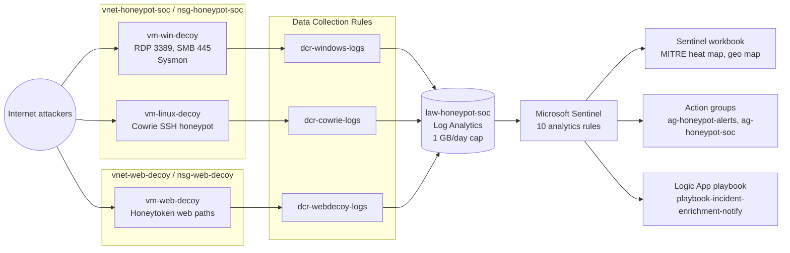

# Honeypot-SOC_Lab.V2


An end-to-end, **infrastructure-as-code** Azure honeypot and SOC detection lab. Three decoy systems are exposed to the public internet, their telemetry flows into **Microsoft Sentinel**, and a layered detection and response pipeline turns raw attacker activity into enriched, MITRE-mapped incidents. Nothing is deployed by hand in the Azure portal: every component is defined in Bicep and shipped by GitHub Actions on each push to `main`.

> **Why this project exists:** to practice the full SOC engineering loop (collect, detect, enrich, respond, and monitor the pipeline itself) against *real* internet attackers rather than simulated data.

---

## Table of contents

1. [Highlights](#highlights)
2. [Architecture](#architecture)
3. [Decoys](#decoys)
4. [Detection coverage](#detection-coverage)
5. [Response and automation](#response-and-automation)
6. [Dashboards and hunting](#dashboards-and-hunting)
7. [Security design decisions](#security-design-decisions)
8. [Repository structure](#repository-structure)
9. [Deployment](#deployment)
10. [Cost controls](#cost-controls)
11. [Lessons learned](#lessons-learned)
12. [Known limitations](#known-limitations)
13. [Roadmap](#roadmap)
14. [Author](#author)

---

## Highlights

- **100% IaC:** networking, VMs, Data Collection Rules, Sentinel onboarding, analytics rules, workbook, and playbook are all Bicep.
- **GitOps deployment:** a push to `main` touching `infra/` triggers the GitHub Actions pipeline.
- **Three decoy types:** Windows RDP/SMB, Linux SSH (Cowrie), and a web decoy with honeytoken paths.
- **10 native Sentinel analytics rules** (scheduled query rules, not legacy Azure Monitor alerts) mapped to MITRE ATT&CK, covering brute force, discovery, persistence, execution, defense evasion, and post-exploitation.
- **Pipeline health monitoring:** rules that alert when a decoy stops sending logs, independent of attack logic.
- **SOAR playbook:** a Logic App with managed-identity authentication enriches and comments on every new incident.
- **Contained by design:** decoys sit in isolated VNets with deny-by-default outbound rules, so a compromised decoy cannot be used to attack anything else.
- **Documented failure:** a real 3-day silent outage is written up as a post-incident review, and the detections that came out of it are in the repo.

---

## Architecture



A full Azure resource view of the deployed resource group is in [`docs/images/rg-honeypot-soc-lab.png`](docs/images/rg-honeypot-soc-lab.png).

### Data flow

1. Attackers hit the decoys; each decoy generates host and application telemetry.
2. **Data Collection Rules** (one per decoy type) route logs to the Log Analytics workspace.
3. **Sentinel analytics rules** run KQL on a schedule and raise incidents with MITRE tactics, techniques, and entity mappings (IP, host, account).
4. **Action groups** send email notifications; the **playbook** enriches each new incident and adds a comment.
5. **Pipeline-health rules** watch the logs themselves, so a silent decoy is itself an alert.

---

## Decoys

| Decoy | Exposure | Telemetry | What it catches |
|---|---|---|---|
| **Windows** (`vm-win-decoy`) | RDP 3389, SMB 445 | Security log, Sysmon (process creation, network connections, file creation) | RDP brute force, post-logon discovery, persistence, PowerShell abuse, log clearing |
| **Linux** (`vm-linux-decoy`) | SSH 22 | Cowrie JSON logs | SSH brute force, shell interaction, command execution, captured payloads |
| **Web** (`vm-web-decoy`) | HTTP 80 | Web access logs | Reconnaissance and scanning against honeytoken paths (`/wp-login.php`, `.env`, `/admin`) |

---

## Detection coverage

All rules are native Sentinel scheduled analytics rules defined in Bicep, with MITRE mapping and entity correlation.

| Rule | Source | Tactic | Technique | Trigger |
|---|---|---|---|---|
| `cowrie-bruteforce-rule` | Cowrie | Credential Access | T1110 | 6+ failed logins / 24h |
| `cowrie-command-execution-rule` | Cowrie | Execution | T1059 | Commands run in a honeypot shell session |
| `cowrie-post-exploit-sequences-rule` | Cowrie | Multiple | Sequence-based | Chained post-login behavior in one session |
| `windows-bruteforce-rule` | Windows Security | Credential Access | T1110 | 5+ failed logons (4625) / 5 min |
| `windows-process-creation-rule` | Sysmon | Execution | T1059 | Suspicious process creation (Sysmon Event 1) |
| `powershell-suspicious-commands-rule` | Sysmon / PowerShell | Execution | T1059.001 | Suspicious PowerShell command lines |
| `windows-discovery-commands-rule` | Sysmon | Discovery | T1082 / T1087 | Enumeration commands (`whoami`, `net`, `systeminfo`, ...) |
| `windows-persistence-attempts-rule` | Sysmon | Persistence | T1053 / T1547 | Scheduled tasks, run keys, new services |
| `event-log-clearing-rule` | Windows Security | Defense Evasion | T1070.001 | Security or System log cleared |
| Web path scanning | Web decoy | Reconnaissance | T1595 | 3+ honeytoken path probes / 10 min |

### Pipeline health

| Rule | Purpose | Trigger |
|---|---|---|
| `cowrie-pipeline-silent-rule` | Detects a silent Cowrie pipeline | No data in 30+ min |
| Web decoy pipeline silence | Detects a silent web decoy | No data in 30+ min |

Detection logic, tuning notes, and YAML definitions live in [`detections/`](detections/).

---

## Response and automation

- **Action groups** (`ag-honeypot-alerts`, `ag-honeypot-soc`) deliver email notifications for detections and incidents.
- **SOAR playbook** (`playbook-incident-enrichment-notify`): a Logic App triggered by new Sentinel incidents. It authenticates with a **system-assigned managed identity** through the `azuresentinel-connection` API connection, enriches the incident, and posts a comment. No stored credentials.
- **Automation rule** attaches the playbook to every new incident.

---

## Dashboards and hunting

- **Sentinel workbook:** MITRE technique heat map, attack geography map, and top-attacker breakdowns.
- **Hunting queries** ([`Hunting_queries/`](Hunting_queries/)): KQL for manual threat hunting across all three decoys.

<!-- Add screenshots here: workbook overview, an incident with entities, the playbook run history -->
<!--  -->

---

## Security design decisions

| Decision | Reasoning |
|---|---|
| Isolated VNets, no peering | A compromised decoy has no network path to anything else. |
| NSGs allow only required inbound ports (3389, 445, 22, 80) | Minimal, intentional exposure. |
| Deny-by-default outbound internet | Decoys can reach Azure Monitor, Azure AD, Storage, and ARM only, so they cannot be used for outbound attacks. |
| Native Sentinel analytics rules, not legacy Azure Monitor alerts | Proper incidents, MITRE mapping, and entity correlation. |
| Managed identity for the playbook | No secrets to leak or rotate. |
| Manual role assignment after first deploy | See below. |
| Secrets only in GitHub Actions secrets | Nothing sensitive in the repo. |

### Why one step is manual

The playbook's managed identity needs the **Microsoft Sentinel Responder** role. This is deliberately a one-time human step, because giving the CI/CD identity permission to create role assignments is a much broader privilege than this pipeline should hold (least privilege).

```bash
az role assignment create \
  --assignee-object-id <playbook-managed-identity-principal-id> \
  --assignee-principal-type ServicePrincipal \
  --role "Microsoft Sentinel Responder" \
  -g rg-honeypot-soc-lab
```

---

## Repository structure

```text
.
├── infra/               # Bicep: networking, VMs, DCRs, Sentinel, analytics rules, workbook, playbook
├── detections/          # Detection logic documentation and YAML definitions
├── Hunting_queries/     # KQL queries for proactive threat hunting
├── scripts/             # Remediation and recovery scripts for decoy VMs
├── docs/                # Architecture images, incident reports
└── .github/workflows/   # CI/CD: deploys infra/ on every push to main
```

Each folder has its own README with more detail.

---

## Deployment

### Prerequisites

- An Azure subscription (a free trial works; see [Cost controls](#cost-controls))
- A GitHub repository with Actions enabled
- Azure CLI installed locally for the one-time role assignment
- An SSH key pair for the Linux decoy

### 1. Configure GitHub secrets

| Secret | Description |
|---|---|
| `AZURE_CREDENTIALS` | Service principal credentials used by the Azure login action |
| `AZURE_SUBSCRIPTION_ID` | Target Azure subscription |
| `VM_ADMIN_PASSWORD` | Windows decoy admin password |
| `VM_SSH_PUBLIC_KEY` | SSH public key for the Linux decoy |
| `ALERT_EMAIL` | Address for detection and incident notifications |

### 2. Deploy

Push a change under `infra/` to `main`. The workflow in `.github/workflows/` validates and deploys the Bicep templates to `rg-honeypot-soc-lab`.

### 3. Post-deployment (one time)

Run the role assignment command from [Security design decisions](#why-one-step-is-manual).

### 4. Verify

- Decoy VMs are running and reporting heartbeats in Log Analytics.
- Analytics rules are enabled in Sentinel.
- The workbook shows incoming data within a few hours of exposure.

### Teardown

```bash
az group delete -n rg-honeypot-soc-lab --yes --no-wait
```

---

## Cost controls

- Log Analytics **daily ingestion cap: 1 GB/day**
- Small VM SKUs for all decoys
- Designed to run on an Azure free trial
- Teardown is a single command, since everything lives in one resource group

---

## Lessons learned

A real **3-day silent outage** (the web decoy crash-looped and no alert fired) is documented in [`INCIDENT_2026-09-21_provisioning_failures.md`](INCIDENT_2026-09-21_provisioning_failures.md).

| What happened | What changed |
|---|---|
| Web decoy failed repeatedly for 3 days with no alert | Added dedicated pipeline-silence rules per decoy pipeline |
| Detection logic alone could not see a *missing* data source | Health monitoring is now treated as a first-class detection category |
| Recovery was manual and slow | Added remediation and recovery scripts in `scripts/` |

---

## Known limitations

- **Threat Intelligence connector is not deployed.** The Microsoft Threat Intelligence connector is excluded from the Bicep templates because it requires tenant verification that is not available on the trial tenant used for this lab. IP enrichment currently comes from the playbook and KQL rather than the native TI feed.
- Incident-response report templates are not yet written.
- Exposed honeypots receive real attacks; this lab is for education and should not share a subscription with production workloads.

---

## Roadmap

- [x] IaC networking, decoys, and logging pipeline
- [x] Sentinel onboarding with native analytics rules and MITRE mapping
- [x] Workbook (MITRE heat map, geo map, top attackers)
- [x] SOAR playbook and automation rule
- [x] Pipeline-health detections
- [ ] Incident-response report templates
- [ ] Native Threat Intelligence connector (pending a tenant that supports it)
- [ ] Integration with HEX WATCH (see below)

---

## Author

**Oludemi Joshua**: Cloud Security Analyst | Blue Team | SOC Analyst | Security Automation

- GitHub: [Bigsnack7](https://github.com/Bigsnack7)
- LinkedIn: [oludemi-joshua](https://www.linkedin.com/in/oludemi-joshua-b6b59141b)

Currently building **HEX WATCH**, an AI-powered SOC platform, developed incrementally as I grow my security engineering and software development skills.
